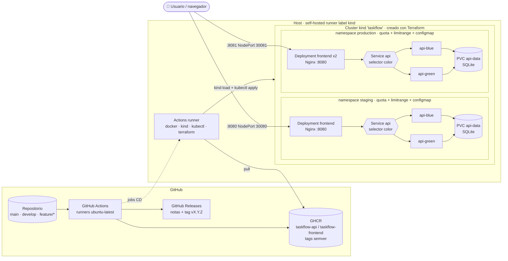
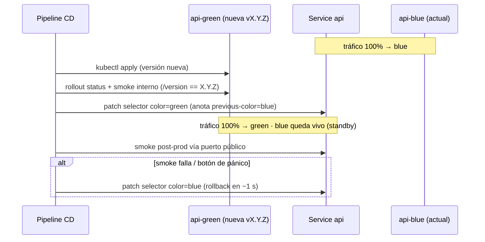

# Arquitectura de software e infraestructura

TaskFlow tiene **2 componentes desplegables** (frontend Nginx + API FastAPI) y una capa de datos
(SQLite sobre un PersistentVolume). Se despliega sobre **Kubernetes (kind)** aprovisionado con
**Terraform**, en **2 ambientes aislados** (namespaces `staging` y `production`).

## Equivalencia con AWS (lo visto en clase)

| AWS (clase)            | Este proyecto (kind)                              |
|------------------------|---------------------------------------------------|
| ECR                    | GHCR (GitHub Container Registry)                  |
| ECS Cluster            | Cluster Kubernetes kind (Terraform `tehcyx/kind`) |
| ECS Service / Task     | Deployment / Pod                                  |
| ALB + Target Groups    | NodePort + Service `api` con selector `color`     |
| CodeDeploy Blue/Green  | `scripts/deploy.sh` + `scripts/rollback.sh`       |
| Cuenta/VPC por ambiente| Namespace + ResourceQuota + LimitRange por ambiente |

## Flujo de una petición
1. El navegador entra a `http://localhost:8081` (production) → NodePort 30081 → Pod Nginx.
2. Nginx sirve la SPA y hace de **gateway**: `/api/*`, `/health`, `/version` → Service `api:8000`.
3. El Service `api` envía el tráfico **sólo** a los Pods del color activo (`blue` o `green`).
4. Ambos colores montan el mismo PVC, por lo que los datos sobreviven al cambio de versión y al rollback.

## Blue/Green

