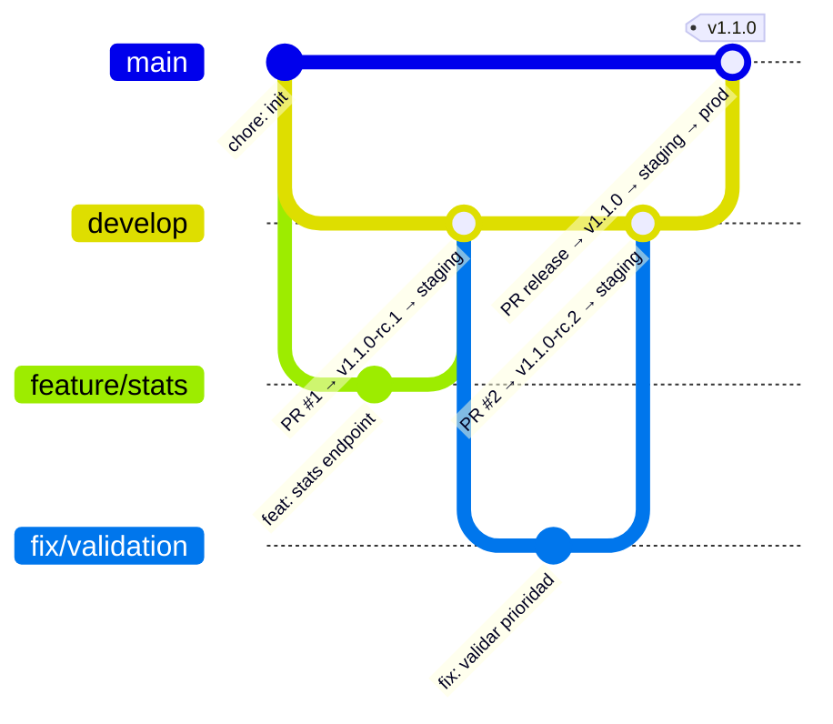

# Estrategia de versionamiento y ramificación

**GitFlow simplificado + Conventional Commits + SemVer automático.**

| Rama / evento | CI | Release | CD |
|---|---|---|---|
| `feature/*`, `fix/*` (push) | ✅ estático + unitario + build + Trivy | ❌ | ❌ |
| PR → `develop` / `main` | ✅ (gate obligatorio para merge) | ❌ | ❌ |
| push `develop` | ✅ | ✅ pre-release `vX.Y.Z-rc.N` + imágenes GHCR | IaC → **staging** → pruebas pre-prod (rollback auto si fallan) |
| push `main` | ✅ | ✅ release `vX.Y.Z` + GitHub Release | IaC → staging → pre-prod → **aprobación** → **production** → post-prod (rollback auto) |
| `workflow_dispatch` cd.yml | — | — | Redeploy de una versión existente (+ opción de simular fallo) |
| `workflow_dispatch` rollback.yml | — | — | 🚨 Rollback manual de staging o production |

## ¿Por qué esta estrategia?
- **Mapeo directo rama ↔ ambiente**: `develop` = staging, `main` = production. Fácil de razonar y de auditar.
- **Gate de calidad**: nada llega a `develop`/`main` sin PR con CI en verde.
- **Versiones automáticas y trazables**: el tipo de commit decide el bump (`fix` → patch, `feat` → minor,
  `feat!`/`BREAKING CHANGE` → major). Sin edición manual de versiones, sin errores humanos.
- **Pre-releases (`-rc`)** en develop: cada build de staging es un candidato identificable que luego se
  promueve tal cual (mismo código) a producción.
- Se consideró **trunk-based**: es lo que recomienda DORA para equipos maduros; para este proyecto el gate de
  aprobación y un ambiente de staging estable justifican una rama de integración (`develop`) de vida corta.
