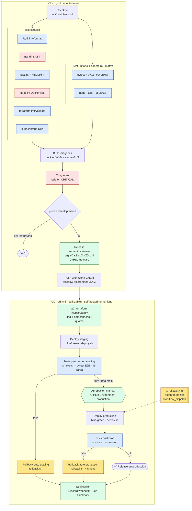

# Diseño del pipeline CI/CD

Leyenda: azul = pruebas · rojo = seguridad · verde = mejoras de pipeline · amarillo = rollback.

## Herramientas por paso

| Etapa | Paso | Herramienta |
|---|---|---|
| CI | Checkout | `actions/checkout@v4` |
| CI | Test estático | Ruff, Bandit, ESLint, HTMLHint, Hadolint, Terraform validate, kubeconform |
| CI | Test unitario + cobertura | pytest + pytest-cov (umbral 80%), node:test + c8 (umbral 80%) |
| CI | Build | Docker Buildx (`docker/build-push-action`) con caché GHA |
| CI | Seguridad imagen | Trivy (`aquasecurity/trivy-action`) |
| CI | Release | semantic-release (Conventional Commits) → tag + GitHub Release; imágenes en GHCR |
| CD | IaC + Deploy infra | Terraform (`tehcyx/kind`, `hashicorp/kubernetes`) → cluster + 2 namespaces |
| CD | Deploy app (×2 ambientes) | kustomize overlays + `scripts/deploy.sh` (blue/green) |
| CD | Tests pre-prod | `scripts/smoke.sh`, pytest + httpx (E2E), k6 (carga) |
| CD | Aprobación | GitHub Environments (required reviewers) |
| CD | Tests post-prod | `scripts/smoke.sh` contra el puerto público de production |
| CD | Rollback automático | job `rollback-*` con `if: failure()` → `scripts/rollback.sh` |
| CD | Rollback manual | `rollback.yml` (workflow_dispatch = botón de pánico) |
| CD | Notificación | composite action `.github/actions/notify` (Discord) + Job Summary |
